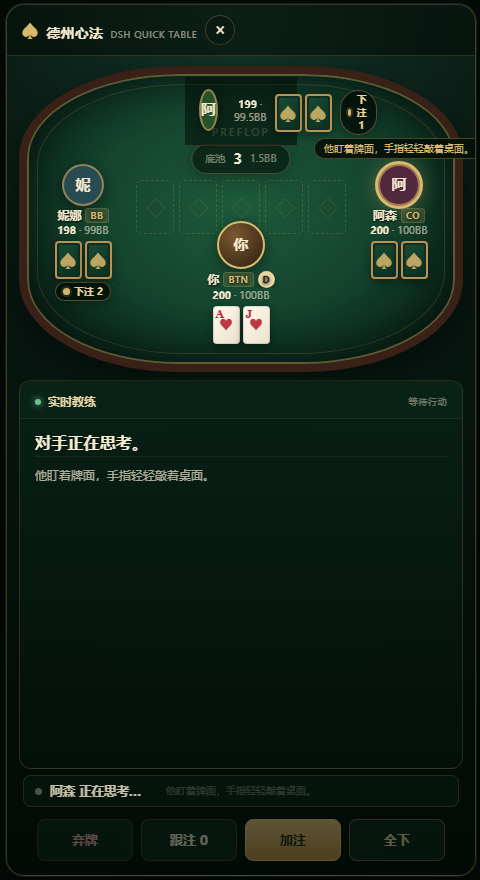

# 德州心法 · 快速牌局

A side-panel Texas Hold'em table with a live coach for DeepSeek Harness.



这不是 APK 的 WebView 套壳。它把德州心法手机版的牌力、范围、胜率、AI 与教练引擎搬进 DSH Client 插件，用 React 重画成一张右侧浮动小牌桌。

## 功能

- 输入框下方「♠ 快速牌局」按钮；右侧约 470px 浮动牌桌，左侧聊天仍可使用。
- 4 人桌：你 + 3 位从固定人设池随机抽取的 AI，100BB，1/2 盲注。
- 弃牌、过牌、跟注、加注、全下；每个对手显示位置、筹码、本轮下注。
- 实时教练：胜率、底池赔率、补牌、SPR、范围估算、更优解、位置与牌面拆解。
- 亮牌结果：公共牌、所有人底牌、最终牌型、赢家与净值。
- 正常牌面：A/K/Q/J/10 + 中央花色；对手显示牌背。
- 关闭后保留当前牌局，`Esc` 关闭；战绩存在本机 `localStorage`。
- 全部逻辑在本地运行，不请求网络、不需要账号。

## 安装

### DSH 内添加本地目录

1. 解压到任意固定目录，例如 `C:\Users\<name>\dsh-poker-mind`；
2. DSH → **Plugins / 插件** → **Add plugin / 添加插件**；
3. 选择包含 `package.json` 的 `dsh-poker-mind` 文件夹；
4. 完全退出并重新打开 DSH；
5. 在对话输入框下方点 **♠ 快速牌局**。

### npm（发布后）

```bash
dsh plugin add dsh-poker-mind
```

### GitHub（发布后）

```bash
dsh plugin add github:easonandkhalil/dsh-poker-mind
```

安装后如果看不到按钮，先完全重启 DSH；只刷新页面可能仍加载旧 Client 模块。

## 开发

```bash
node src/build-client.cjs
node --check client.js
node tests/smoke-client.cjs
node tests/flow-client.cjs
```

`src/engine/` 是独立复制的牌力、范围、胜率、AI、教练与角色数据；`src/ui.js` 是 React 牌桌；构建产物是 `client.js`。

## 与 Android 版的差异

| 能力 | Android 版 | DSH 版 |
| --- | --- | --- |
| 运行方式 | 独立 APK，离线安装 | DSH Client 插件 |
| 入口 | 桌面图标 | 对话输入框下方按钮 |
| 牌桌 | 图片桌布、24 张 AI 头像、语音与音效 | CSS 自绘、无图片/语音，右侧浮动 |
| AI 人数 | 可选 1–5 个 | 固定 3 个 |
| 教练 | 新手实时 + 专家盘后复盘 | 新手实时教练 |
| 牌局库 | 34 手真实牌局博物馆 | 未包含 |
| 对手图鉴 | 24 位完整图鉴 | 仅随机抽取，不展示图鉴页 |
| 100 手自画像 | 有 | 仅存手数/胜场/净 BB |
| 数据 | APK 本地存储 | `localStorage`，与 APK 不互通 |

## 限制

- 需要支持 `shell.overlay` 与 `conversation.composer.dock` 的桌面版 DSH。
- 教练在主线程做蒙特卡洛，低配机器首次计算可能短暂停顿。
- 不是完整 Android 版移植。

## License

MIT
